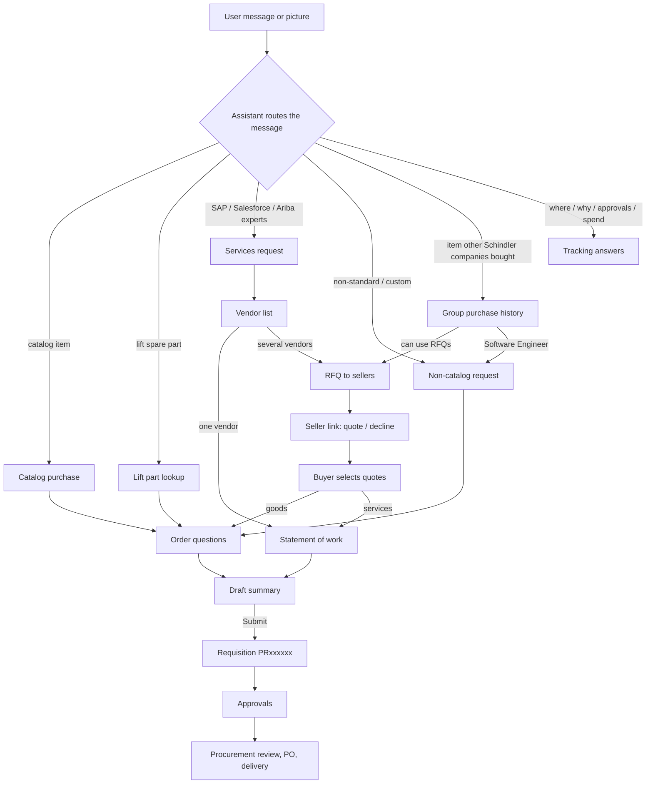
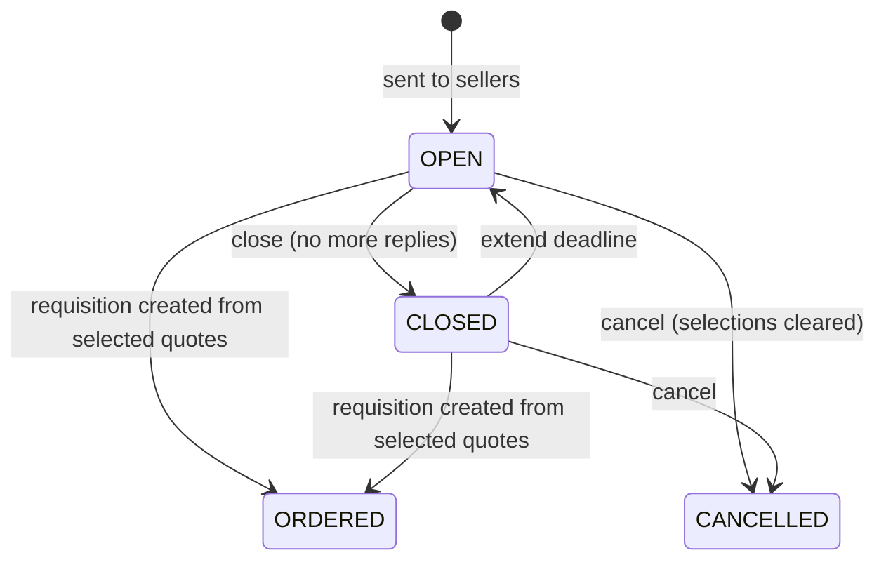
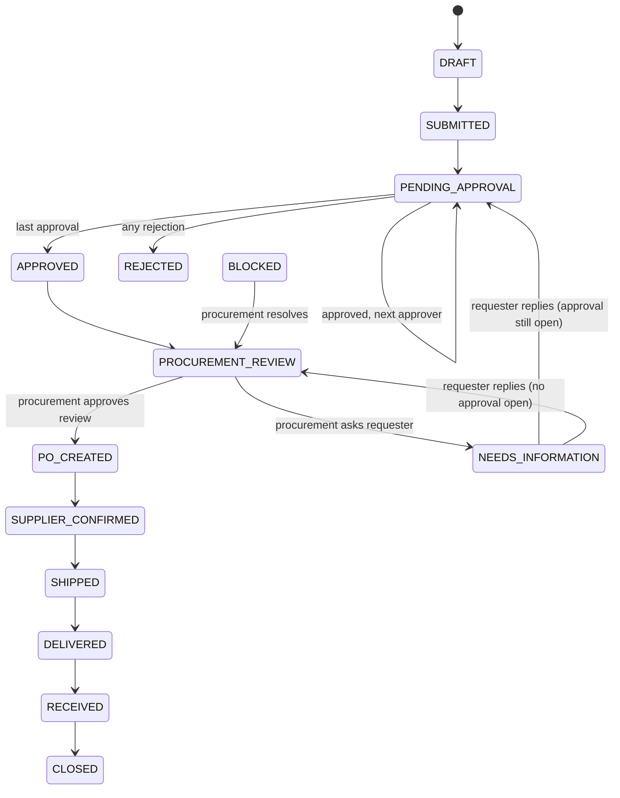

# Guided buying: how the flow works

This document walks through the guided-buying experience end to end: how a request starts in chat, the questions the assistant asks, how approvals are routed,a how requests for quotation (RFQs) run, and what happens after a requisition is submitted.

> **Source:** the `dev` branch (commit `d046dcd`), `src/modules/guided-buying` plus the routes under `src/app/(app)/guided-buying` and `src/app/(public)/guided-buying`. The module is not on `main` or `prod`.
>
> **Everything runs on a mock backend.** `MockAribaAdapter` keeps requests and RFQs in the browser's localStorage (`gb.demo.v1`) and re-seeds them after 24 hours. Only the IT catalog is live: it comes from ServiceNow through `/api/catalog`. The assistant is rule-based (regular expressions), not an LLM.

---

## 1. Screens and routes

All paths sit under the app's base path, `/procurement-agent`. Nothing in the main app links to guided buying yet, so you open it by URL.

| Route | Screen | Sign-in |
|---|---|---|
| `/guided-buying` | Chat with the assistant, plus the library panel | Azure (MSAL) through `AuthProvider` |
| `/guided-buying/requests` | Requests list (the name depends on role, see below) and the insights panel | Azure |
| `/guided-buying/requests/[id]` | One request | Azure |
| `/guided-buying/rfqs` | RFQ list. Hidden for Software Engineers | Azure |
| `/guided-buying/quote/[token]` | The page a seller opens from the RFQ email to quote or decline | **Public.** The token in the link is the only credential. Not indexed, no referrer |

`GuidedBuyingShell` draws the tab bar: **Chat**, **Requests**, and **RFQs** (with a badge counting RFQs that need attention). It also draws the persona switcher, the chat history popover, and the request and RFQ drawers. The chat stays mounted while you move between tabs, so a conversation isn't lost.

Tab names change with the role:

| Role | Requests tab | RFQs tab |
|---|---|---|
| employee | My Requests | My RFQs |
| manager | Team Requests & Approvals | Team RFQs |
| procurement | Procurement Queue | RFQ Queue |

## 2. Demo personas

The switcher offers four seeded users. The choice is saved in localStorage (`poc-user`). Switching persona saves the current chat to history and starts a fresh one.

| Persona (id) | Title / role | Manager | Cost center, budget | What the persona shows |
|---|---|---|---|---|
| Rajeev P (`u-rajeev`), **default** | Engineering Lead / employee | Anita | CC-1001, €40,000 | Buying for a team: laptops, monitors, lift parts, services, RFQs |
| Hari D (`u-priya`) | Software Engineer / employee | Rajeev | CC-1002, €900 | Tight budget; **can't use RFQs** |
| Anita Desai (`u-anita`) | Engineering Director / manager | — | CC-1001, €120,000 | Approves her team's requests and sees their RFQs |
| Pavan Rao (`u-pavan`) | Category Manager / procurement | — | CC-4001 | Procurement approver; sees every request and RFQ |

Each persona gets its own suggested prompts (`PERSONA_PROMPTS` in `lib/policy.ts`). They show until the first message is sent.

## 3. The big picture

Nothing is created until the user confirms a draft. Every reply carries a **trace** (intent, entities, policy check, contract check, recommendation), which the chat can show to explain how the answer was reached.

## 4. How the chat routes a message

`respond()` in `lib/assistant.ts` tries these checks in order. The first one that matches handles the message.

1. **A picture**, or a follow-up about the picture already in the conversation. The picture is "recognised" from keywords in its file name; a generic name falls back to the Dell laptop the demo uses. If the item is in the catalog and allowed, the assistant offers **Proceed with this …**, which starts a normal catalog order.
2. **RFQ words from a role that can't use RFQs** (Software Engineer). The assistant refuses.
3. **A draft is waiting.** "yes / confirm / submit" submits it; "no / discard" drops it.
4. **An RFQ is being set up but not sent.** "send it" uses the suggested sellers for each product; "send it to all sellers" uses every seller that can quote; "add …" adds items; "cancel" drops the RFQ.
5. **Order questions are in progress.** The message answers the open question. The user can also say "skip", "use defaults", "change delivery", "change charge" or "cancel". A message starting with where / show / what / who / … leaves the questions and is routed normally.
6. **Questions asked inside a request drawer**, about that request: cancel, remind, change, approvers, cost, supplier, PO, delivery date, delay, next step.
7. **RFQ messages:** open or manage a numbered RFQ (remind, extend, invite, close, cancel, create the requisition), start one ("get quotes for …"), or list them.
8. **Follow-ups on a product list:** "compare 1 and 3", "the second one", "why these?".
9. **Tracking and approvals:**
   - "What needs my action?"
   - "How much have I spent…?" (requests raised this year, without rejected, cancelled or draft ones)
   - "Which requests have been waiting more than N days?"
   - "Who needs to approve …?"
   - "Cancel …"
   - "Where is / why is … delayed?"
10. **Items outside the catalog that other Schindler companies have bought** (`lib/kgs.ts`). See section 9.
11. **Lift spare parts.** See section 6.
12. **Browsing:** "what can I buy", "list vendors", "vendors who provide SAP services".
13. **Services:** "3 SAP Ariba experts for 6 months". See section 7.
14. **Non-standard or custom items.** See section 8.
15. **Anything else** is treated as a catalog search. See section 5.

After a requisition is submitted, the conversation closes ("start a new chat for your next request").

## 5. Flow A: catalog purchase

Example: *"I need a laptop for new joinee starting next week"*, or *"I need 20 monitors for our Hyderabad office"*.

1. **Read the message.** The assistant picks out the quantity, who it's for (a named colleague, otherwise the user), the office location and any date.
2. **Eligibility.** The request stops if the recipient is a contractor, has no cost center, or (once a product is picked) the total is above their remaining budget.
3. **Search and rank** the catalog (lift parts excluded). The score combines relevance ×5, policy ×4, contract ×3, preferred contract ×2, delivery ×1 and price ×2. Only the subcategory of the best match is shown. If none of those options is compliant, up to two compliant alternatives are added. "cheap" puts the cheapest first and drops blocked items; "under €X" filters by price.
4. **Product card.** Compliant options come first, each with its reasons and warnings. The user picks one, or ticks several to order them together.
5. **Order questions** (see the table below). Delivery address (the user's office) and cost center are prefilled from the profile and confirmed rather than asked. Purpose and need-by are taken from the message when it says them.
6. **Draft summary.** Items, total, approvers, warnings and the answers given. Nothing exists in Ariba yet.
7. **Submit.** The budget is checked again, then the mock creates the requisition (`DRAFT`) and submits it (`SUBMITTED` → `PENDING_APPROVAL`). The reply names the approvers in order.

### Policy checks on each product (`evaluateProduct`)

| Check | Result |
|---|---|
| Supplier not approved | **Blocked** |
| Item outside the catalog, e.g. Apple devices | **Exception**: needs exception approval |
| Laptop over €1,500 for an engineer, developer or lead (not a director or manager) | **Exception** |
| Total above the recipient's remaining budget | **Blocked** |
| No active contract with the supplier | Warning |
| No contract and total above €5,000 | Warning: procurement review |
| Total above €10,000 | Warning: manager and procurement approval |
| Delivery time later than the required date | Warning |

### Approval route (`approvalRoute`)

- The **requester's manager** always approves first. If the requester has no manager in the seed data, it falls back to Anita.
- **At most one** further approver, Pavan (procurement), for the first of these that applies:
  1. any line is an exception → "Exception: non-standard item"
  2. total above €10,000 → "Procurement approval (> €10,000)"
  3. lines without a contract add up to more than €5,000 → "Procurement review (non-contract > €5,000)"

Drafts, edited drafts and requisitions created from an RFQ all use this same rule.

### Order questions for goods (`lib/intake.ts`, `nextQuestion`)

Each question is asked only when it applies. Every question except the estimated cost (non-catalog flow) can be skipped; skipping records its default.

| Question | Asked when |
|---|---|
| Purpose | Always, unless the message says it |
| New joiner's name | Purpose is "New joiner" and the order isn't for a named colleague |
| Primary work (picks the software image) | New joiner and a laptop |
| Replaced asset tag | Hardware replacement |
| Stand or monitor arm / delivery batches | Monitors / more than 5 monitors |
| Assembly | Furniture |
| New SIM or transfer number | Phone or mobile |
| Deliver to, then site / address | Always (prefilled); site when branch, depot or customer site |
| Charge to, then WBS / order no. | Always (prefilled); WBS when not the cost center |
| Needed by | No date in the message |
| Confidential data | Laptop or phone, and the message hints at it or the department is Finance / HR |
| Customer-facing use | Sales, laptop or phone, demo or customer words in the message |
| Floor / area, EHS review | Operations department |
| Sourcing route (contract or quick RFQ) | The user is in procurement |
| Accessories | Laptop |
| Justification | Exception, above €5,000, or urgent |

Some answers add warnings to the draft: confidential data (ICT imaging and encryption), EHS review, delivery to a site, a replacement (return the old device), a WBS charge, and lead time later than the need-by date.

## 6. Flow B: lift spare parts

Example: *"I need a door roller for a Schindler 3300 lift"*, or *"I need 8 door rollers and 2 brake lining sets for our Schindler 300P lifts"*.

1. **Find the part (`liftlookup`).** The assistant asks for the lift model (from the nameplate) and the part, skipping whatever the message already says. Only parts that fit that model are shown. OEM parts come first.
   - Several parts in one message are matched one by one and can be ordered in one request.
   - If the model is unknown or "not sure", the assistant won't guess. It offers to pick a model, or to raise the order as a non-catalog item.
   - If no part fits, it offers to browse part groups, change the model, or go non-catalog.
2. **Order questions (`liftpart`):**
   - Order reason
   - Is the lift out of service? (asked for a breakdown; "yes" sets need-by to 3 days and marks the request urgent)
   - Unit (installation) number
   - Will the faulty part be returned? (breakdown or warranty)
   - Is a certified technician assigned? (safety-critical parts)
   - Delivery point (service depot, customer site, van stock, or OEM Spare Parts Centre)
   - Charge (cost center, service order / maintenance contract, or WBS)
   - Need-by
   - Justification (exception or above €5,000)

   Unlike office goods, delivery and charge are asked rather than prefilled, except when the order comes from an RFQ.
3. **Policy:** an aftermarket part is an exception (technical and procurement approval). An aftermarket part for a safety-critical component (braking, door protection, overspeed) is **blocked**. A safety-critical OEM part carries a warning that a certified technician must fit it and record it in the lift logbook.
4. Draft and submit work as in flow A.

Lift parts that are in the catalog are always ordered at the catalog price. Asking for quotes on them sends the user to this flow instead.

## 7. Flow C: services (SAP, Salesforce, Ariba experts)

Example: *"I need 3 SAP Ariba experts for a new project"*.

1. The assistant reads the skill, how many experts, and the duration (3 months if none is given). It asks: **upload a SOW** or **answer questions**?
2. **With a SOW:** the upload is "parsed" with canned values. If the SOW names a vendor, the vendor choice is skipped and the order goes straight to the summary at that vendor's contract rate.
3. **Without a SOW:** questions on the engagement type, work mode, start, duration, certifications, hourly-rate ceiling, and access to systems or data. Procurement users are also asked for the sourcing route. Charge comes from the profile.
4. **Vendor list:** approved vendors for the skill, within the rate ceiling, with resources supplied over 3, 6 and 12 months. Requester names are visible only to managers and procurement.
   - **Several vendors → services RFQ.** Replies are due in 5 days, and one vendor only answers after a reminder. The user selects a vendor in the RFQ details, then **Continue** reopens chat at the SOW step.
   - **One vendor → direct**, estimated at the contract rate × 160 h × months × experts.
5. **SOW:** "Draft SOW with AI" (a template filled from the brief) or upload one.
6. **Draft:** approvers are the manager, then Pavan ("Procurement approval (> €10,000)" or "Procurement review (services)"). The route reads Manager → Procurement → SOW review. Going over budget gives a warning but doesn't block the request. Answering "yes" to system or data access adds an NDA and access-review warning.

## 8. Flow D: non-catalog / custom request

Triggered by words such as *non-standard, custom, prototype, not in catalog*, e.g. *"I need custom 3D-printed prototype parts for €6,200"*. It is also used for unmatched lift parts, and by Software Engineers in place of an RFQ.

- **Questions:**
  - Purpose (and why no catalog item fits)
  - Preferred supplier, and its name if there is one
  - One-time or recurring
  - Need-by
  - EHS review (Operations)
  - Customer project and WBS (Engineering)
  - **Estimated cost in EUR.** This one can't be skipped, because it decides the approval route.
- **Draft:** approvers are the manager, then Pavan ("Procurement review (non-catalog)"). The route text adds "Finance (non-contract spend > €5,000)" and "Procurement approval (> €10,000)" by amount, but no extra approver is added for them (see section 13). Going over budget is a warning only.

## 9. Flow E: items other Schindler companies have bought → RFQ

`lib/kgs.ts` lists items that are **not in the catalog** but that other Schindler companies have purchased: thermal imaging camera, rope tension gauge, shaft plumb laser, torque wrench set, fall-arrest harness, ATEX inspection lamp, 4-gas detector, label printer, and discontinued or refurbished Schindler 300P parts.

Example: *"I need 4 thermal imaging cameras"*, or *"Get quotes for 4 thermal imaging cameras"*.

1. The assistant shows the purchase history: how often each item was bought and by which companies, a reference price, and the sellers they used (with rating and contract number).
2. **If the user can run RFQs:** **Request quotes from these sellers** builds an RFQ basket.
   - The user chooses which sellers get each product. By default each product goes to every seller that can quote it, except that the aftermarket parts seller isn't suggested for safety-critical lift parts.
   - The user can add more items ("also add 2 gas detectors") and set the reply time (default 5 days, 1–30).
   - **Send** creates `RFQ-50xx` and gives every seller a personal reply link.
3. **If the user is a Software Engineer:** **Raise a non-catalog request** goes to flow D, with the amount estimated from the reference price.
4. Asking for quotes on catalog items gets the reply that they are ordered directly at the contract price. An item found in neither list is offered as a non-catalog request.

## 10. RFQ lifecycle

The list and the details show a **phase** worked out from the status and the replies, each with a "next step" line:

| Phase | Meaning | Needs attention |
|---|---|---|
| Awaiting replies | Sellers still pending, deadline not passed | |
| Overdue | Deadline passed, sellers still silent: remind, extend or close | ✔ |
| No quotes | Every seller declined: invite more or cancel | ✔ |
| Quotes received | Quotes in, not every product has a selected quote | ✔ |
| Quotes selected | Every product has a quote: create the requisition (goods) or continue with the vendor (services) | ✔ |
| Closed | Closed with no quotes | |
| Requisition created | Ordered; shows the PR number | |
| Cancelled | Withdrawn | |

**Mock sellers.** Each invited seller gets one of four behaviours, fixed by a hash of the RFQ and seller ids: `reply` (quotes at once), `late` (quotes after a reminder), `silent`, or `decline` (with a reason).

**Who can act.** Only the person who sent the RFQ, or procurement, can act on it. Nothing can be changed once it is `ORDERED` or `CANCELLED`.

| Action | Available when |
|---|---|
| Select a quote per product | Any quote exists |
| Remind | `OPEN` and sellers still pending |
| Extend deadline | Always; reopens a `CLOSED` RFQ |
| Invite more sellers | `OPEN`; new sellers quote straight away in the mock |
| Close | `OPEN` |
| Create requisition | Goods RFQ with at least one selected quote |
| Cancel | Always (asks to confirm) |

**Who can see an RFQ.** Procurement sees every RFQ. A manager sees their own and their reports' RFQs, up to five levels down. Other users see RFQs they sent or that are for them. Software Engineers see none.

**Quote flags** (`quoteFlags`):
- Aftermarket part → exception.
- Aftermarket part for a safety-critical line → **blocked**.
- No contract with the seller → note. No contract and above €5,000 → exception.
- Lead time later than the need-by date → note.

The **recommended** quote is the cheapest allowed quote, preferring ones with no flags and breaking ties by the shortest lead time.

**Messages.** The buyer can write to one or several sellers; each seller has its own thread and never sees the others. Mock sellers (except silent ones) answer after 4–6 seconds, and sometimes send a lower price as an updated quote. The buyer sees unread counts and the earlier prices.

**Turning quotes into a requisition** (goods):
- **From the RFQ details:** a form shows only the questions an RFQ order still needs: delivery, site, charge, WBS, need-by, justification, unit number, technician. Delivery, charge and need-by are prefilled from the profile or the RFQ.
- **From chat:** *"Create a requisition from RFQ-5001"* asks the same questions one by one.

Products without a selected quote are left out. Submitting creates the PR the same way as flow A and links it to the RFQ (`ORDERED`).

## 11. The seller's page

Each seller gets a personal link, `/procurement-agent/guided-buying/quote/<token>` (a random 96-bit token). The page needs no sign-in. Through it the seller can:

- see only the products that were sent to them, with the buyer's message and dates
- **send a quote**:
  - per product: unit price and lead time (lift parts also OEM or aftermarket); for services, hourly rate, number of people and start date
  - for the whole quote: validity date, warranty, a note, and up to 5 files of at most 10 MB each (stored in the browser's IndexedDB in the mock)
- **decline**, with a reason
- **update the quote** after quoting, while the RFQ is open or closed. Each update is posted to the buyer's thread showing what changed
- read and answer the buyer's messages

A closed RFQ takes no new quotes but still accepts updates. An ordered or cancelled RFQ shows a notice instead.

In the demo the seller page only works **in the same browser as the buyer**, because the state is in localStorage. A change in one tab reaches the others through the `storage` event.

## 12. After submit: the requisition lifecycle

Each status maps to an Ariba-style status, e.g. `PENDING_APPROVAL` → "Composing/Approving", `PO_CREATED` → "Ordering", `BLOCKED` → "On hold".

**Buttons on a request** (`requestActions` in `lib/policy.ts`; drawer in `components/RequestWorkspace.tsx`):

| Who | When | Action → result |
|---|---|---|
| The next pending approver | `PENDING_APPROVAL` | **Approve** → next approver, or `APPROVED` after the last one. **Reject** → `REJECTED` |
| Requester | `NEEDS_INFORMATION` | **Provide information** → back to approval or review |
| Procurement | `PROCUREMENT_REVIEW` | **Approve review** → `PO_CREATED`: a PO number is issued and expected delivery is set 7 days out. **Request information** → `NEEDS_INFORMATION` |
| Procurement | `BLOCKED` | **Resolve block** → `PROCUREMENT_REVIEW` |
| Requester | `PENDING_APPROVAL` | **Remind approver**: shows a note only, no state change |
| Requester | Active and not shipped, delivered or received | **Cancel** (asks to confirm) → `CANCELLED` |

Approvers can also approve or reject straight from a row of the requests list.

**Detected exceptions.** These are flags on a request, not status changes (`detectExceptions`):
- Approval pending longer than 48 h → approval delayed.
- PO created more than 48 h ago without supplier confirmation → supplier delayed (critical).
- Blocked → critical.
- Needs information.
- Required within 5 days and not yet shipped → due soon.

**Requests list.** The scopes are:
- **All**
- **Needs my action:** shown to managers and procurement, and to anyone with something pending. It opens first when something is pending.
- **Active**
- **Closed**
- **Exceptions:** procurement only.

You can also filter by status and search by PR number, title or PO. Who sees what:
- **Procurement:** every request.
- **Everyone else:** requests they raised, requests raised for them, and requests where they are named as an approver.

## 13. Gaps and behaviour to know before wiring a real backend

1. **An approved request never moves on.** After the last approval a request sits at `APPROVED`. Procurement's buttons only appear at `PROCUREMENT_REVIEW`, and `adapter.advance()` (the method that steps a request forward) is never called. Every status from `SUPPLIER_CONFIRMED` onward exists only in seeded data.
2. **Anita and Pavan approve their own requests.** Neither has a manager in the seed data, so the manager approval falls back to Anita.
3. **Only one extra approver at most.** An exception that is also above €10,000 lists Pavan once, with the exception reason only.
4. **The non-catalog route promises more than it assigns.** It names Finance (> €5,000) and procurement approval (> €10,000), but only the manager and Pavan are added as approvers.
5. **Submitting doesn't reduce the budget.** `budgetRemaining` is never lowered, so a user can raise several requests that together exceed it.
6. **Fixed reject comment.** Rejecting from the UI always records "Rejected in demo"; no comment is asked for.
7. **Reminders and notifications are simulated.** Approver reminders, RFQ notifications and "sellers were notified" only add text or log entries.
8. **Seller links only work in the same browser.** Seller links depend on localStorage, so they only work where the buyer's state lives.
9. **Simulated AI.** Picture recognition uses the file name, and SOW parsing returns canned values.
10. **ServiceNow env var names.** `/api/catalog` reads `NEXT_PUBLIC_SERVICENOW_CATALOG_URL`, `…_USERNAME` and `…_PASSWORD`. The `NEXT_PUBLIC_` prefix is meant for values that may reach the browser, which a password shouldn't. The route's error message names them without the prefix.

## 14. Where to look in the code

| Concern | File |
|---|---|
| Routes and the tab shell | `lib/routes.ts`, `components/GuidedBuyingShell.tsx` |
| App state: chat, history, persona, drawers | `lib/store.tsx` |
| Message routing and every chat flow | `lib/assistant.ts` (`respond`, `handleAction`) |
| Order questions | `lib/intake.ts` |
| Policy, approval route, exceptions, permissions | `lib/policy.ts` |
| RFQ rules, phases, sellers, quote flags | `lib/rfq.ts`, `lib/rfqMessages.ts` |
| Seller link | `lib/sellerLink.ts`, `components/SellerQuote.tsx` |
| Mock backend (the API contract to replace) | `lib/adapter.ts` (`ProcurementAdapter`) |
| Seed data | `lib/seed.ts`, `lib/rfqSeed.ts`, `lib/kgs.ts` |
| Live catalog | `src/app/api/catalog/route.ts`, `lib/catalog.ts` |
