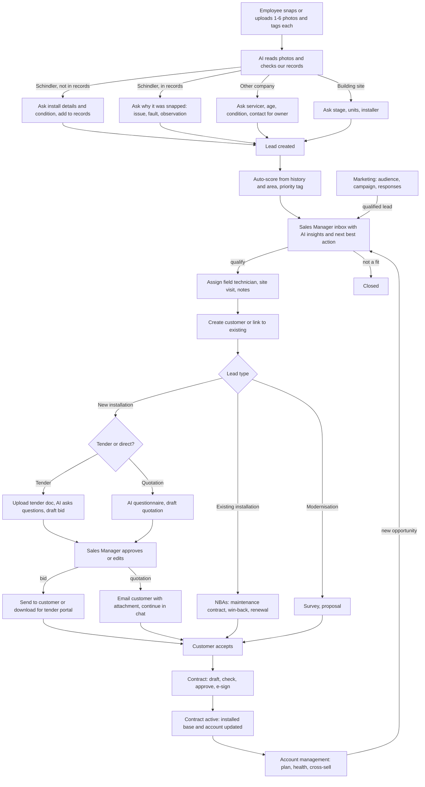
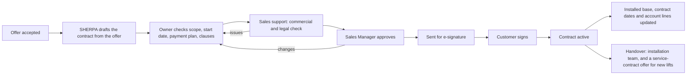
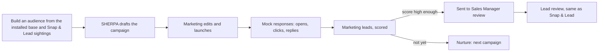

# Snap to deal: the end-to-end flow

This document describes the target process, from an employee snapping a lift to a won bid, quotation or service contract. For each step it says what the code does today and what is missing, and it ends with a task list.

> **Everything is mocked.** Customers, AI replies, tender documents, emails and the CRM are simulated in the browser (`lib/store.tsx` state, seeded in `lib/data.ts` and `lib/sherpa.ts`). The only real AI call is the optional photo reader `app/api/read/route.ts`, which needs `ANTHROPIC_API_KEY`. Without the key the chat falls back to asking the user. New AI steps follow the same rule: mock by default, real model only if a key is set.

Legend: ✅ built · 🟡 partly built · ❌ missing

---

## 1. Two apps, one state

| App | Route | Root | Who |
|---|---|---|---|
| Snap & Lead | `/snap` | `components/apps/SnapRoot.tsx` → `components/reporter/ReporterApp.tsx` | The employee who reports (`alex`, Arjun Rao) |
| SHERPA | `/` | `components/apps/SherpaRoot.tsx` → `components/desk/Desks.tsx` | Sales manager (`marc`), reps (NI, EI, SC, MOD), sales support, account manager, admin |

Both apps share one state (`lib/store.tsx`). A report sent in Snap & Lead becomes an **Item** (a lead, ticket or records task) on the report. Each lead item also becomes an **Opp** (opportunity) in SHERPA through `OP.fromReport` (`lib/sherpa.ts`). The Opp is the single record from lead to won deal. Tender, bid and offer are stages of it.

## 2. The big picture

---

## 3. Step by step

### 3.1 Capture and tag photos

The employee takes photos with the camera or uploads several at once. Each photo can carry a tag.

| What | Status | Where |
|---|---|---|
| Live camera, retake, switch camera | ✅ | `components/reporter/CameraPanel.tsx` |
| Upload several files at once, limit of 6 | ✅ | `Assistant.tsx` `onFiles`, `addToStage` |
| Tag per photo: presets (Elevator, Notice board, Building map) or the user's own tag, kept for the rest of the chat | ✅ | `components/reporter/PhotoTag.tsx`, `tagStaged` |
| Tags used by the analysis (for example "Building map" means location, not a unit) | ❌ | Tags are only labels today |
| Duplicate photo warning | ✅ | `dupMessage` in `Assistant.tsx` |

### 3.2 Read the photos and check our records

The AI reads brand, unit number, service sticker and age, then looks the unit up in our records.

| What | Status | Where |
|---|---|---|
| Photo reader (real Claude call when a key is set, otherwise the preset reading) | ✅ | `app/api/read/route.ts`, `analyse()` in `Assistant.tsx` |
| Reading card: "Is this correct?" with fixes for brand, number, age, equipment | ✅ | `analyse`, `fixMenu`, `applyFix` |
| Records lookup result (`found`, `missing`, `wrong`, `multiple`, `placeOnly`, ...) | 🟡 | Comes from the preset (`Preset.backend.records`), not from a lookup against `sherpa.assets` |

### 3.3 The conversation branches

The chat asks only what the case needs (`nextQ`, `formFields` in `Assistant.tsx`).

**A. Schindler lift, not in our records.** Goal: add it to the installed base and capture condition.

| Question | Status |
|---|---|
| Unit number (if not read) | ✅ |
| How is it running (fine, minor, out of service, unsafe) | ✅ |
| Who services it (sticker) | ✅ |
| How many lifts in the building | ✅ |
| Install details for the record: floors, capacity, approximate age, building contact | 🟡 `LeadInfo` holds these, but they are edited after sending (`LeadInfo.tsx`), not asked in the chat |
| A records item for the records steward (`RS`) is created | ✅ `evaluate()` in `lib/engine.ts` |
| The unit is actually added to `sherpa.assets` once the steward confirms | ❌ |

**B. Schindler lift, already in our records.** Goal: find out why the employee snapped it.

| Question | Status |
|---|---|
| Show what we know (contract, last service, open tickets) | 🟡 the reading card shows it, the contract comes from the preset |
| "Why did you snap it?" (fault seen, customer complaint, looks old, contract question, just passing) | ❌ Today only "How is it running?" is asked |
| Follow-ups per reason (what was the issue, did people get stuck, did someone complain) | ❌ |
| Fault → service ticket, ended contract → renewal lead, old with faults → modernisation lead | ✅ `evaluate()` |

**C. Another company's lift.** Goal: give a Schindler sales rep what they need to approach the owner for maintenance, or modernisation if the lift is due for an upgrade.

| Question | Status |
|---|---|
| Who services it | ✅ |
| How is it running | ✅ |
| How many lifts | ✅ |
| Approximate age or install year | 🟡 read from the photo, not asked |
| Who is the owner or person in charge, can we contact them | 🟡 optional contact step (`optContact`), not targeted at the owner |
| Is the owner unhappy with the current servicer | ❌ |
| Win-back, conversion or modernisation lead | ✅ `evaluate()` |

**D. Building site.** Stage, number of units, who is installing, already ordered. ✅ This becomes a new installation lead (NI).

**Safety.** If the lift is unsafe, the emergency path runs first (`safetyFlow`, `sendUnsafe`). ✅

### 3.4 Lead created, scored and tagged

| What | Status | Where |
|---|---|---|
| Lead created at the end in every branch (or info, records, ticket where no lead fits) | ✅ | `evaluate()` in `lib/engine.ts` |
| Score from rules: base points per case plus modifiers (units, building type, condition, age, key customer) | ✅ | `lead()`, `mods()` in `lib/engine.ts` |
| Priority tag Hot, Warm, Cold or Info | ✅ | `tierOf()` |
| Score also from history in the area (past win rate, prices, earlier leads at the place) | ❌ | `regionRef` and `winChance` in `lib/sherpa.ts` exist for offers but do not feed the lead score |
| The score shows its reasons | ✅ | `Draft.reasons` |

### 3.5 Sales Manager reviews and qualifies

**Target:** every lead goes to the Sales Manager first. The manager sees AI insights and the next best action, qualifies the lead, and assigns it.

**Today:** leads go straight to the area owner for that team (`routeItem` in `lib/store.tsx`). Only when no owner covers the area, or the owner declines, does it fall to the manager (`marc`) as an "Assign an owner" task.

| What | Status | Where |
|---|---|---|
| Manager inbox of all new Snap & Lead leads | ❌ | Manager sees team pipeline and exceptions (`ManagerOverview`, `TeamPipeline`) |
| AI insights per lead (history at the place, similar wins, risk) | 🟡 | `NbaCard` and `nbaFor` in `components/desk/Action.tsx` give one NBA per item. No place history |
| Next best action catalogue | ✅ | `CATALOG`, `computeNbas` in `lib/sherpa.ts` (27 actions) |
| Qualify: tender, direct, not a fit | ✅ | `OP.qualify`, but it runs **after** the visit and by the owner |
| Override tier with a reason | ✅ | `Item.override` |

### 3.6 Field technician visit and notes

**Target:** the manager assigns a field technician, who visits, talks to the person in charge and records findings. Notes are added at every stage.

| What | Status | Where |
|---|---|---|
| Visit task, visit done with a note | ✅ | `OP.contacted`, `OP.visited` |
| Visitor is the rep (or the MOD rep for a survey), not a technician | 🟡 | `visitorFor()` |
| Field technician as a SHERPA user | ❌ | `tom` exists only as a hidden reporter |
| Structured site-visit form (floors, shaft size, power, decision-maker, timeline) | ❌ | |
| Notes on every stage | 🟡 | `Opp.log` records events. No free "Add note" on the Opp page |

### 3.7 Create or link the customer

| What | Status | Where |
|---|---|---|
| New account created if none exists | ✅ | `ensureAccountFor()`, called from `OP.qualify` |
| Match to an existing account by place | ✅ | `OP.fromReport` |
| Manager confirms "new customer" or picks an existing one | ❌ | Silent today |

### 3.8 The three paths

#### New installation

Qualify decides between **tender** and **quotation**.

**a. Tender bid**

| What | Status | Where |
|---|---|---|
| Tender record with checklist of bid papers | ✅ | `OP.qualify` (tender), `BID_PAPERS` |
| Upload the tender document | ❌ | |
| AI reads the document (mock: a canned extraction) and lists requirements | ❌ | `liftDetails()` in `Bid.tsx` parses only the tender summary |
| AI asks questions where the document is silent | ❌ | |
| Draft bid from answers, past quotes and region prices | 🟡 | `BidPage`, `PastQuotes`, `fillPapers` |
| Sales support completes the configuration | ✅ | `config` task |
| Sales Manager reviews, edits, approves | ✅ | `OP.bidDone`; the manager builds the bid today |
| Send to the customer | ✅ | `send` task, `emailFor` |
| Download the bid (PDF) for the tender portal | ❌ | |

**b. Quotation**

| What | Status | Where |
|---|---|---|
| Direct offer drafted from account data and region price | ✅ | `SH.makeOffer` |
| AI questionnaire before the draft (floors, load, speed, finish, timeline) | ❌ | |
| AI analysis shown with the draft (win chance, price against the region) | ✅ | `RegionCard`, `winChance`, `DiscountGauge` |
| Manager approval, ask for changes, reject | ✅ | `OP.onOffer` (`submitted`, `approved`, `changes`, `rejected`). Only when the discount is above 10% |
| Every quotation goes to the manager | ❌ | Under 10% skips approval today |
| Email with the quotation attached | 🟡 | Email draft exists (`emailFor`). No attachment |
| Customer chat after sending (mock replies) | ❌ | |

#### Existing installation

| What | Status | Where |
|---|---|---|
| NBAs for an existing unit: competitor-serviced (9), handed over without contract (23), renewal at risk (7), contract ending (3), repair need (10) | ✅ | `computeNbas` |
| NBAs shown when the lead is opened, for converting it to a maintenance contract | 🟡 | NBAs live on the Today list and account views, not on the Opp page of a Snap & Lead lead |
| Maintenance offer from the lead | ✅ | `OP.qualify` → `maintenance` or `renewal` product |

#### Modernisation

Not described yet in the brief. Today: MOD rep surveys (`visitorFor`), then a modernisation offer. Assume it follows the quotation path with a survey step first, unless told otherwise.

### 3.9 Contract creation

**Target:** a deal the customer accepts becomes a contract. The contract is drafted from the offer, checked, approved, signed by the customer and then switched on. Only a signed contract counts as won.

| What | Status | Where |
|---|---|---|
| Offer marked won | ✅ | `SH.outcome`, `OP.onOffer("won")` |
| Hand-over task to the SC rep after a new installation or modernisation is won | ✅ | `OP.onOffer("won")` (N25) |
| Contract record (scope, term, start, payment plan, SLA, clauses, value) | ❌ | |
| Draft generated from the offer, the quotation answers and the tender | ❌ | |
| Commercial and legal check by Sales support, with SHERPA flags (payment terms, liability, price escalation) | ❌ | |
| Sales Manager approval | ❌ | |
| E-signature (mock: customer signs from a link) and signed PDF | ❌ | |
| Activation: unit contract end and value, account lines, NewCRM write-back | ❌ | |
| Opportunity stage **Contract** between Sent and Won | ❌ | |

**Assumptions:** one contract per won offer. Payment plans are fixed per product: new installation 10% advance, 60% on delivery, 30% on handover; modernisation 30/50/20; service contracts quarterly in advance. Sales support (Shalini Nair) does the commercial and legal check. Customer signing is simulated.

### 3.10 Account management

**Target:** the Account Manager (and the Sales Manager) see every customer in one place: installed base, contracts, open deals, health, contacts and a written account plan. SHERPA points out what to do next. New opportunities raised here go through the same Sales Manager review as Snap & Lead leads.

| What | Status | Where |
|---|---|---|
| Key accounts page with key-customer sightings | 🟡 | `AccountDesk` in `Desks.tsx`, `AccountOverview` in `Dash.tsx` |
| NBAs: key account silent 60 days (24), cross-sell NI, service, MOD (25), new unit handed over (23) | ✅ | `computeNbas` |
| Account list: health, installed base, lines active, contracts ending, open pipeline, last activity | ❌ | |
| Account page: units, contracts, opportunities, contacts, activity | ❌ | |
| Account plan: goals, actions with owners and dates, white space (lines not active) | ❌ | |
| Log a meeting or call, add a contact | ❌ | |
| Raise an opportunity from the account (cross-sell, renewal, modernisation) into Lead review | ❌ | |

**Assumptions:** the Account Manager owns key accounts and can see all accounts; reps see the accounts of their own deals and units; the Sales Manager sees all. Health follows the rules in section 8.

### 3.11 Marketing

**Target:** Marketing finds groups of customers or buildings worth a campaign, SHERPA drafts the message, the campaign goes out (mock), responses come back as leads, and qualified leads go to the Sales Manager's Lead review like any other lead.

| What | Status | Where |
|---|---|---|
| Campaigns and leads page | 🟡 | `Campaigns` in `Work.tsx` |
| Campaign drafted from chat (Ask SHERPA) | 🟡 | `SH.apply` `campaign` effect |
| Assign a marketing lead to a rep | 🟡 | `SH.apply` `assign` effect, bypasses the manager |
| Leads not followed up in 48 h (NBA 27) | ✅ | `nudgeLeads` |
| Audience builder: area, age, brand, servicer, contract ending, building type, live count | ❌ | |
| SHERPA-drafted message with subject and body, editable | ❌ | |
| Campaign results funnel: sent, opened, clicked, replied, leads, opportunities, won | ❌ | |
| Lead scoring (fit and engagement) and "Send to Sales Manager" into Lead review | ❌ | |
| Nurture list for leads that are not ready | ❌ | |

**Assumptions:** sending, opens and replies are simulated by a "Simulate responses" demo button. Marketing leads with a score of 60 or more are offered for review; Marketing decides when to send them.

---

## 4. Task list

Ordered so each task builds on the one before. Each is small enough for one change.

**Progress (13 Nov 2026):** tasks 1–22 and 24–40 are built. Task 23 (modernisation) waits for the brief; for now modernisation leads use the quotation path with a scope question. The status tables in section 3 describe the code before these changes.

| Persona | What they see now |
|---|---|
| Reporter (Snap & Lead) | Tag-aware photo reading, records lookup against the installed base, "Why did you snap it?" for our lifts on record, record details for missing lifts, owner and servicer questions for other companies' lifts |
| Sales Manager | Default page **Lead review**: every new lead by tier with score reasons (history reasons in red), SHERPA insight and next best action. Qualify assigns the owner and the technician. Approves every quotation (can change the discount) and every bid (can edit or send back) |
| Service lead (Srikanth Naidu, Farhan Ali) | **My jobs**: won new installations in their area, handover pack, accept the job with a start date and site contact |
| Field technician (Teja Goud, Anil Kumar) | Phone-first **My site visits** (leads other than new installations): site-visit form (who they met, lifts, floors, condition, who decides, timeline, supplier, notes) |
| Sales rep (owner) | After the visit: confirm a new or existing customer, then tender or quotation (new installation) or next best actions (existing installation). Uploads the tender document, answers what it leaves open, submits the draft bid. Quotation questionnaire, then a priced draft. Sends with a PDF attachment and keeps talking to the mock customer on the offer |
| Admin | Toggle: every quotation needs the Sales Manager, or only discounts above the guideline |
| Sales rep (contract) | When the customer accepts, SHERPA drafts the contract. The owner sets the start date and optional terms, sends it for the check, then for e-signature. "Customer signs (demo)" activates it |
| Sales support (Shalini Nair) | **Contracts** page: checks each contract next to SHERPA's flags, passes it or sends it back with a note |
| Sales Manager (contract) | Approves the checked contract or asks for changes. Sees **Accounts** and **Contracts** |
| Account Manager (Lakshmi Prasad) | **Accounts**: health, lifts, deals, contracts, white space, next best actions, account plan with actions (each becomes a task), contacts, activity log. Raising an action sends a lead to Lead review |
| Reps | **My accounts**: accounts of their own lifts and deals |
| Marketing (Manoj) | **Marketing** is the start page: audience builder with a live count, SHERPA-drafted message, campaign funnel with "Simulate a day of replies", scored leads with Send to the Sales Manager or Nurture |

### Phase 1: capture and conversation

1. **Use photo tags in analysis.** "Building map" and "Notice board" photos skip the unit reader and feed location or notice handling. Files: `Assistant.tsx` (`analyseStaged`, `analyse`).
2. **Real records lookup (mock).** Look up the read number and place in `sherpa.assets` instead of the preset's `backend.records`. Keep presets as demo overrides. Files: `Assistant.tsx` (`buildInput`), `lib/sherpa.ts`.
3. **"Why did you snap it?" for our lifts in records.** New question key `reason` with options (fault seen, customer complaint, looks old, contract question, just passing) and follow-ups per option. Map answers to `Input` (`condition`, `breakdowns`, a new `reason` field). Files: `Assistant.tsx` (`nextQ`, `QTEXT`, `opts`, `applyOne`), `lib/types.ts`.
4. **Record details for our lifts not in records.** Ask floors, capacity, install year and building contact in the chat, saved into `Report.info`. Files: `Assistant.tsx`, `LeadInfo.tsx`.
5. **Owner questions for other companies' lifts.** Ask who is in charge, whether they are open to a call, and whether they are unhappy with the current servicer. Add the answers to the score. Files: `Assistant.tsx`, `lib/engine.ts` (`mods`).
6. **Add the confirmed unit to the installed base** when the records steward accepts a records item. Files: `lib/store.tsx`, `lib/sherpa.ts`.

### Phase 2: scoring and the manager

7. **History-based score.** Add reasons from the area: win rate for the product (`regionRef`), earlier leads or wins at the place, contract history. Files: `lib/engine.ts`, `lib/sherpa.ts`.
8. **Route every lead to the Sales Manager first.** New Opp stage before `new` (for example `review`). The manager qualifies, then assigns an owner. Keep emergencies and service tickets going straight to their desks. Files: `lib/store.tsx` (`routeItem`), `lib/sherpa.ts` (`OP.fromReport`, new `OP.review`), `lib/types.ts` (`OppStage`).
9. **Manager lead inbox.** A list of leads waiting for review, sorted by tier, each with score reasons, AI insight (mock text from place history) and the suggested NBA. Actions: qualify and assign, change tier, not a fit. Files: `components/desk/Desks.tsx`, new `components/desk/LeadReview.tsx`.

### Phase 3: visit and customer

10. **Field technician role in SHERPA.** Add a technician user with a phone-first desk: their visits, a site-visit form, notes, photos. Files: `lib/data.ts` (`USERS`, `ROLE_LABEL`, `roleHome`), `lib/types.ts` (`Role`), `components/desk/Desks.tsx`.
11. **Manager assigns the technician** at qualification. `visitorFor` returns the chosen technician. Files: `lib/sherpa.ts`.
12. **Notes on every stage.** An "Add note" box on the Opp page writing to `Opp.log`, plus the visit form's notes. Files: `components/desk/Opps.tsx`, `lib/sherpa.ts`.
13. **Confirm the customer.** After the visit, the manager confirms "new customer" or picks an existing account (suggested by name and place). Files: `lib/sherpa.ts` (`ensureAccountFor`), `components/desk/Opps.tsx`.
14. **Existing installation NBAs on the lead.** Show the matching NBAs on the Opp page for existing-installation and win-back leads, with "Draft maintenance offer". Files: `components/desk/Opps.tsx`, `lib/sherpa.ts` (`computeNbas`).

### Phase 4: tender bid

15. **Tender document upload.** Upload a PDF on the tender. Mock extraction returns requirements (lifts, floors, speed, load, EORD, competitor spec, papers needed) from a canned set. Files: `components/desk/Bid.tsx`, `lib/types.ts` (`Tender.doc`).
16. **AI questions from the document.** Ask only what the document leaves open, then fill the draft bid. Files: `components/desk/Bid.tsx`, a mock in `lib/agents.ts`.
17. **Rep drafts, manager approves.** The owner submits the draft bid. The manager reviews, edits price, discount and papers, then approves. Today the manager builds it. Files: `lib/sherpa.ts` (`OP.bidDone` split into submit and approve).
18. **Download the bid** as a PDF (print stylesheet or a generated file) for the tender portal, next to "Send to customer". Files: `components/desk/Bid.tsx`.

### Phase 5: quotation

19. **Quotation questionnaire.** AI asks floors, load, speed, finish and timeline, then drafts the quotation with its analysis. Files: `components/desk/Offers.tsx`, `lib/sherpa.ts`.
20. **Manager approval for every quotation** (configurable in admin), with edit, ask for changes and reject. Files: `lib/sherpa.ts` (`approversFor`), `lib/data.ts` (`DEFAULT_CFG`).
21. **Email with attachment.** The sent email shows the quotation PDF as an attachment. Files: `components/desk/Offers.tsx`, `lib/sherpa.ts` (`emailFor`).
22. **Customer chat.** After sending, a chat thread on the offer with mock customer replies (questions, counter-offer, accept). Accept marks the offer won. Files: new `components/desk/CustomerChat.tsx`, `lib/sherpa.ts`.

### Phase 6: modernisation

23. **Modernisation path.** Survey by the technician or MOD rep, then the quotation flow. Waiting for the brief.

---

### Phase 7: contract creation

24. **Contract model and draft.** `Contract` type; on offer won, draft from the offer (scope, term, start, payment plan, clauses, SLA). Opportunity stage `contract`. Files: `lib/types.ts`, `lib/contracts.ts`, `lib/sherpa.ts` (`OP.onOffer`).
25. **Owner check.** Contract page: edit start date, payment plan choice, optional clauses; submit for check. Files: new `components/desk/Contract.tsx`, `components/desk/Opps.tsx`.
26. **Sales support check.** SHERPA flags (mock) and pass or send back. Task for Sales support.
27. **Sales Manager approval**, with send-back.
28. **E-signature (mock)** and signed PDF download.
29. **Activation:** update units (contract end and value), account lines, NewCRM write-back, installation handover and service-contract offer.

### Phase 8: account management

30. **Accounts list** for the Account Manager, Sales Manager and reps (their accounts). Files: new `components/desk/Accounts.tsx`, `lib/accounts.ts`.
31. **Account page:** units, contracts, opportunities, contacts, activity, NBAs.
32. **Account plan:** goals and actions, white space; log a meeting; add a contact.
33. **Raise an opportunity** from the account into Lead review.

### Phase 9: marketing

34. **Audience builder** with a live count. Files: rework `Campaigns` into new `components/desk/Marketing.tsx`, `lib/marketing.ts`.
35. **Campaign draft and launch** with a SHERPA-drafted message.
36. **Simulated responses and funnel.**
37. **Lead scoring, nurture, and Send to Sales Manager** into Lead review.

### Phase 10: draft review inside SHERPA

38. **One draft editor for the quotation, the bid letter and the contract.** The draft shows as a document, section by section. People with the right to change it click a section to edit it, ask SHERPA to rewrite it (shorter, more formal, plain words), reset it to SHERPA's draft, or comment on it. Price and payment sections come from the record and are read only. A section nobody edited keeps following the record. Files: `lib/drafts.ts`, `components/desk/DraftEditor.tsx`, used in `Offers.tsx`, `Bid.tsx`, `Contract.tsx`.
39. **SHERPA review beside the draft (mocked).** Risks and improvements are worked out from the record and the draft text, each with **Apply fix**, **Show me** and **Dismiss**, plus **Apply all**:
    - Quotation: no validity; a discount above the guideline with no reason; an opening that ignores the site visit; "as agreed" instead of dates; no breakdown response time on service offers.
    - Bid letter: a competitor's part named in the tender while the letter claims full compliance; a customer we lost on price (lead with lifetime cost); no delivery time; no exclusions; no validity.
    - Contract: the commercial guideline flags; no completion date; yearly escalation off; first-year maintenance off; changed standard legal wording (Sales support must check).
40. **Who can change what.** Quotation: the rep while drafting or after changes are asked; the Sales Manager while approving. Bid letter: the rep while drafting; the Sales Manager while approving. Contract: the rep in draft; Sales support during the check; the Sales Manager during approval. Others with a stake can comment; a comment pings the owner. Every change goes into the draft's own history. The print window is only for the final PDF (approved bid, signed contract).

## 5. Decisions (13 Nov 2026)

1. **Every sales lead goes to the Sales Manager first**, Hot included. The manager decides **Pursue** or **Not pursue** (with a reason). Emergencies, service faults and records items still go straight to their desks.
2. **New installations: no technician visit.** The new-lift rep accepts the lead, finds the contact (with Sales support's records search if needed) and calls or visits the customer. Other lead types keep the technician site visit.
3. **New-installation tenders: the Sales Manager prepares the bid.** Sales support fills in the lift details first and reviews the terms and papers after; the rep confirms the bid matches the customer's request and sends it. Other tenders keep "rep drafts, manager approves".
4. **Quotations need the manager only above the discount guideline (10%).** Admin can switch back to "every quotation".
5. **New installations end in an order, not a contract.** Customer agreed → Sales Manager approves the win → Sales support creates the order (this is the win) → the area's service lead accepts the job. Other deal types keep the contract, check and e-signature steps.
6. **UI rule: details open in a side panel, not a page.** Deals, offers, bids, contracts, accounts and the campaign builder open over the list; a panel opened from another panel stacks and closing it returns to the one below. **Filters stay behind a Filters button**; only the filters in use show, as removable chips.

### New installation flow

| # | Who | Step | Task kind | Code |
|---|---|---|---|---|
| 1 | Lead generator | Snaps the building; lead created | – | Snap & Lead |
| 2 | Sales Manager | Pursue (picks the NI rep) or Not pursue (reason) | `review` | `OP.review`, `OP.reviewClose` |
| 3 | NI rep | Accepts | `accept` | `OP.accepted` |
| 4 | NI rep | No contact: asks Sales support what to find (contact, tender document, project owner), asks the reporter, or finds them alone | `findContact` | `OP.research`, `OP.askReporter`, `OP.selfContact` |
| 5 | Sales support | Searches building permit, company register, customer records; shares what fits. Never calls | `research` | `researchFindings`, `OP.shareResearch` |
| 6 | NI rep | Records the conversation: how, with whom, what was said, what they want. Outcome: quote, tender (attach document), call back (reminder), not interested (closed with reason) | `contact` | `OP.talk` |
| 7q | NI rep | Quotation questions, priced draft | `quoteBrief`, `revise` | `OP.quoteBrief`, `SH.submit` |
| 8q | Sales Manager | Approves only above 10% | `approve` | `SH.decide` |
| 7t | Sales support | Fills in the lift details from the tender | `config` | `OP.answerGaps` |
| 8t | Sales Manager | Prepares the bid: price, papers, competitor part | `bid` | `OP.bidDone` |
| 9t | Sales support | Reviews terms and papers | `bidReview` | `OP.bidReviewed` |
| 10t | NI rep | Confirms the bid matches the request | `bidConfirm` | `OP.bidConfirmed` |
| 11 | NI rep | Sends the quote or bid | `send` | `SH.send` |
| 12 | NI rep | 14-day follow-up: reminder, changed quote, mark bid final, customer said no | `followup` | `SH.chase`, `OP.markFinal`, `SH.outcome` |
| 13 | NI rep | Customer agreed: price, start, how, proof attached | `agreed` | `OP.agreed` |
| 14 | Sales Manager | Approves the win or asks for a change | `approveWin` | `OP.winDecision` |
| 15 | Sales support | Creates the order (number, delivery, payment terms). **Won** | `order` | `OP.createOrder` |
| 16 | Service lead | Reads the handover pack, accepts the job with start and site contact | `job` | `OP.acceptJob` |
| after | SC rep, Account manager, Marketing | Maintenance offer, account update, campaign link | `handover`, `accountAction`, `other` | `OP.createOrder` |

A lost or not-pursued deal keeps its reason (`Opp.lostReason`); the next deal at the same customer or place shows "Why we lost here last time" (`lastLoss`).

## 6. Open questions

1. **Modernisation** details: survey questions and whether it can also go to tender.
2. **Customer chat**: inside SHERPA only for now, with mock customer replies.

## 7. Demo story: one lead from photo to signed contract

Follow these steps in order. Each person's list is sorted newest first, so the story's lead is always the **top row**. Switch person with **Switch role** (the bar under the phone, or the menu on your avatar). Snap & Lead is at `/snap`, SHERPA is at `/`.

**Before you start:** avatar menu → Demo controls → **Reset demo data**. The cast:

| Person | Role | App |
|---|---|---|
| Arjun Rao | Reporter (any Schindler employee) | Snap & Lead |
| Madhav Reddy | Sales Manager | SHERPA |
| Teja Goud | Field technician | SHERPA (phone) |
| Meera Krishnan | Modernisation sales rep (the owner) | SHERPA |
| Shalini Nair | Sales support | SHERPA |
| Lakshmi Prasad | Account manager | SHERPA |
| Manoj Verma | Marketing | SHERPA |

### Chapter 1: the snapped lift becomes a signed modernisation

| # | Who | Do this | You should see |
|---|---|---|---|
| 1 | Arjun Rao, `/snap` | **Take or upload photos**, add any two photos, tag one **Elevator**, tap **Analyse** | "Where is it?" |
| 2 | Arjun | **Search for a building** → **Banjara Central Mall, Block B** → brand **Schindler** → **Yes, looks right** | A short form |
| 3 | Arjun | Unit number **61102**. Condition **Minor issues**. Why did you snap it: **It looks old or worn** → **All of it**. Who services it: **Ours (Schindler)**. Lifts: **2 to 4**. Contact: *Sandhya Reddy, centre manager* | |
| 4 | Arjun | **Review the lead** → **Create lead** | Lead created. 61102 is a 27-year-old unit on record, so SHERPA files a **Hot modernisation lead, score 100** |
| 5 | Madhav Reddy, `/` | **Lead review** (opens by default). Top row: *Banjara Central Mall, Block B*, Hot 100 | Score reasons, SHERPA insight, next best action "Book a modernisation survey" |
| 6 | Madhav | Open it. Owner: **Meera Krishnan** (suggested), technician: **Teja Goud**. Add a note if you like → **Qualify and assign** | The lead leaves the review list |
| 7 | Teja Goud (phone) | **My visits** → top row → site-visit form: met *Sandhya Reddy, Centre manager*, lifts *3*, floors *G+4*, condition **Wear and small faults**, decides **The person I met**, timeline **Now** → **File the site-visit report** | Visit filed |
| 8 | Meera Krishnan | **My work** → top row "Set up the deal" → **Start the quotation** | Quotation questions |
| 9 | Meera | **1,000 kg (13 persons)**, **1.75 m/s**, **Controller and drive** → **Draft the quotation** → **Open OF-…**. In *The quotation the customer gets*, SHERPA review shows 1 risk and 2 improvements → **Apply all 3 fixes** (or edit a section by clicking it). Hover the Opening → **Comment**: *OK to mention the site visit?* → set the discount to **12%** → **Send for approval** | The opening now names Teja's visit, delivery has dates, validity is added. 12% is above the 10% guideline, so it goes to the Sales Manager |
| 10 | Madhav | **My work** → top row → **Review and decide**. Read the draft, see Meera's comment → **Resolve** (edit any wording if you like) → move the discount if you like → **Approve at …%** | |
| 11 | Meera | Top row → **Open OF-…** → **Write the email** (the quotation is attached; **Review it** jumps to the draft) → **Send to customer** | Customer chat opens |
| 12 | Meera | Answer the customer three times (any text). After the third reply the customer agrees → **Mark as won** | The deal moves to **Contract**; SHERPA drafts the contract |
| 13 | Meera | Top row → **Open the contract draft**. SHERPA review: **No completion date** → **Apply fix**. Check the start date and optional terms → **Send for the commercial check** | |
| 14 | Shalini Nair | **Contracts** (or My work, top row) → the contract → read the draft and SHERPA review (edit or comment if needed) → **Check passed** | |
| 15 | Madhav | **Contracts** → the contract → **Approve** | |
| 16 | Meera | Top row → **Send for e-signature** → **Send for e-signature** → **Customer signs (demo)** | Contract **Active**, deal **Won**, handover task created |
| 17 | Lakshmi Prasad | **Accounts** → top row *Banjara Retail Pvt Ltd* | Modernisation line now active, the signed contract under Deals and contracts, the signing in Activity |
| 18 | Arjun Rao, `/snap` | **My leads** → top row | **Won**, +275 points (accepted, quote sent, won) |

### Chapter 2: the account manager grows the account

| # | Who | Do this | You should see |
|---|---|---|---|
| 1 | Lakshmi Prasad | **Accounts** → *Banjara Retail* → Next best actions → **Raise for review** on "Win the service on 1 unit serviced by others" | "Sent for review" |
| 2 | Lakshmi | Account plan: add an action for Imran Baig, due in 1 week | Imran gets a task |
| 3 | Madhav Reddy | **Lead review** → top row is the account lead, "from Account plan" | Qualify as in chapter 1, steps 6 to 16 |

### Chapter 3: marketing brings in a warm lead

| # | Who | Do this | You should see |
|---|---|---|---|
| 1 | Manoj Verma | **Marketing** (opens by default) → **New campaign** | Audience builder with a live count |
| 2 | Manoj | Keep the audience, goal **Modernisation** → **Draft the message with SHERPA** → **Save the campaign** | Draft campaign |
| 3 | Manoj | **Send to … contacts** → **Simulate a day of replies (demo)** | Funnel fills, scored leads appear |
| 4 | Manoj | **Leads** → top row → **Send to the Sales Manager** | "With Madhav" |
| 5 | Madhav Reddy | **Lead review** → top row is the marketing lead | Qualify as in chapter 1, steps 6 to 16 |

### Chapter 4: a new building becomes an order

Every step below already has a seeded deal waiting, so you can show any step without doing the earlier ones.

| # | Who | Open | Do this |
|---|---|---|---|
| 1 | Madhav Reddy | **Lead review** → *Attapur Riverfront* | See "Why we lost here last time". **Pursue with Naveen** |
| 2 | Naveen Chowdary | My work → *Narsingi Greens* | **Accept** |
| 3 | Naveen | *Narsingi Greens*, after accepting | If there is no contact yet: **Ask Sales support** and tick what to find (contact details, tender document, project owner) |
| 4 | Shalini Nair | My work → *Tellapur Grand* | Tick the findings → **Share with Naveen** |
| 5 | Naveen | *Manikonda Residency* | Record the call → **Wants a quote** → answer the quotation questions |
| 6 | Shalini | *Financial District Tower 4* | **Fill in the lift details** in the bid builder |
| 7 | Madhav | *Nanakramguda One* | **Prepare the bid** |
| 8 | Shalini | *Begumpet Square* | Tick the terms → **Terms and papers are fine** |
| 9 | Naveen | *Malkajgiri Central* | **It matches** → send the bid |
| 10 | Naveen | *Kokapet Skyline* (quote sent) | **Customer agreed** → price, start, proof → send |
| 11 | Madhav | *Shamshabad Gateway* | **Approve the win** |
| 12 | Shalini | *Miyapur Orchid Towers* | **Create the order**: the deal is won |
| 13 | Srikanth Naidu | **My jobs** → *Bachupally Meadows* | Read the handover pack → **Accept the job** |

### Other paths to show

- **Tender (new installation):** Madhav qualifies *Kokapet Skyline (building site)* for Naveen Chowdary. Naveen sets up the deal → **Tender** → uploads the tender document → answers the open questions → **Draft the bid** → in **5 · The bid letter** SHERPA flags 2 risks and 2 improvements (lost here before on price, no delivery time, no exclusions, no validity) → **Apply all** → submits the draft bid. Madhav reads and edits the letter, then approves, then Naveen downloads or sends the bid.
- **Another company's lift (existing installation):** Madhav qualifies *Cyber Gateway, Tower A* for Eshwar Varma. After the visit, Eshwar picks a next best action ("Draft this offer").

## 8. How the scores are worked out

Every score has an ⓘ next to it. Click it to see the same breakdown for that lead, lift or account. The rules live in `lib/scores.ts` (and `winChanceWhy` in `lib/sherpa.ts`), so the numbers and the explanations come from the same code.

| Score | Where | Rule |
|---|---|---|
| **Lift health** (0–100) | Portfolio, account lifts | Starts at 100. Minus 1 per year of age over 5 (at most 25), 3 per callback in 90 days (at most 30), 3 per callback more than the 90 days before (at most 15), 4 per out-of-service fault in 90 days (at most 20), 2 per callback in the last 14 days, 10 if a part is discontinued. Below 45 is at risk, 45–69 needs watching, 70+ is good. |
| **Account health** (0–100) | Accounts list and account page | The average health of the account's lifts (70 if none), minus 10 per contract ending within 90 days, minus 2 per fault in 90 days across all lifts (at most 20). Below 50 shows in "Health below 50". |
| **Lead score** (0–100) and tier | Lead review, deal review step | Base points for what was spotted (set in Admin → Rules), plus or minus modifiers (units, building type, condition, age, contact met, key customer), plus History points from our past quotes and customers in the area. Hot 70+, Warm 45–69, Cold 20–44, Info below 20 (thresholds are in Admin). |
| **Win chance** (%) | Offer price check, SHERPA offer options | The share of our past offers for the same product in the same area that were won, counting only offers within 6 points of this discount. If fewer than 3 are that close, all discounts count. |
| **Marketing lead score** (0–100) | Marketing → Leads | Replied 30, fits the audience 10 (or 20 for a lift 20+ years old in a modernisation campaign), existing customer 10, asked for a call or survey 15, otherwise opened 2+ emails 5. 60+ is marked "Ready for sales"; Marketing decides whether to send it to the Sales Manager or nurture it. |

